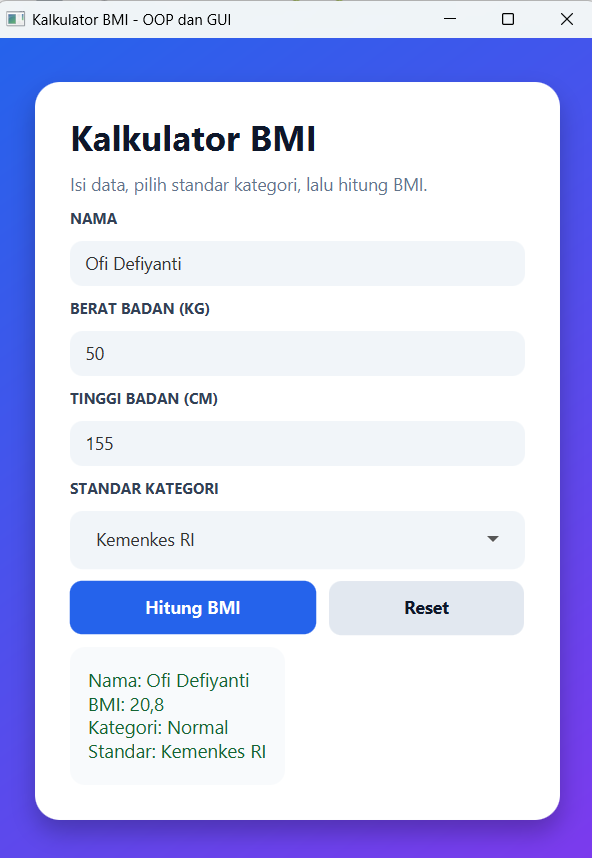
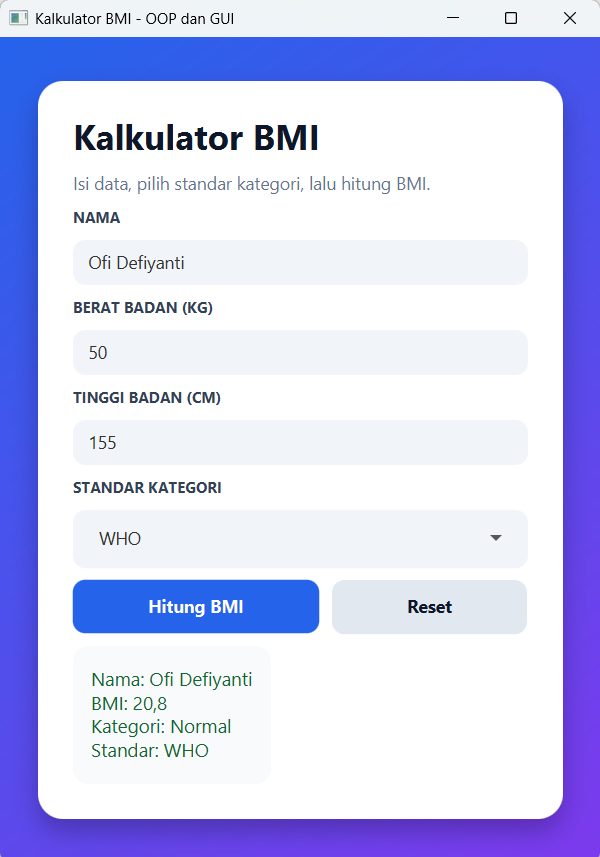

# Kalkulator BMI

### Yuk, kenali tubuhmu lebih dekat!

Kalkulator BMI adalah aplikasi desktop sederhana yang membantu kamu menghitung Indeks Massa Tubuh (BMI) berdasarkan berat dan tinggi badan.

Aplikasi ini dibuat menggunakan Java dan JavaFX dengan tampilan yang simpel, interaktif, dan mudah digunakan. Cukup masukkan data diri, klik tombol hitung, dan hasil BMI kamu akan langsung muncul!

---

## Tampilan Aplikasi

### Standar Kemenkes RI

### Standar WHO

## Fitur Aplikasi

- Memasukkan nama pengguna
- Mengisi berat badan dalam kilogram
- Mengisi tinggi badan dalam sentimeter
- Menghitung BMI secara otomatis
- Menampilkan hasil dan kategori BMI
- Mengosongkan data dengan tombol reset

---

## Teknologi yang Digunakan

| Teknologi | Kegunaan |
|---|---|
| Java 17 | Bahasa pemrograman utama |
| JavaFX 21 | Membuat tampilan aplikasi |
| FXML | Mengatur layout GUI |
| CSS | Mempercantik tampilan aplikasi |
| Maven | Mengelola dependency dan project |

---

# Cara Menjalankan Aplikasi

Pastikan laptop kamu sudah memiliki:
- Java Development Kit (JDK) 17
- Apache Maven (jika menjalankan aplikasi melalui terminal)
- NetBeans IDE atau IDE Java lainnya

Untuk memeriksa apakah Java sudah terinstal, buka CMD atau terminal lalu jalankan:
java -version

Untuk memeriksa Maven:
mvn -version

Jika kedua perintah menampilkan informasi versi, berarti Java dan Maven sudah tersedia.

## Download atau Clone Repository

1. Clone repository menggunakan perintah: git clone https://github.com/ofidefiyanti/BMIApp.git
2. Setelah proses selesai, masuk ke folder project: cd BMIApp
3. Jika tidak menggunakan Git, buka halaman repository GitHub, pilih Code → Download ZIP, lalu ekstrak file ZIP ke folder yang diinginkan.

## Menjalankan melalui NetBeans IDE

1. Buka NetBeans IDE.
2. Pilih menu File → Open Project.
3. Cari dan pilih folder project BMIApp yang sudah di-download atau di-clone.
4. Tunggu hingga NetBeans membaca project dan Maven mengunduh dependencies yang diperlukan.
5. Pastikan project berhasil dibuka tanpa pesan error.
6. Klik kanan project BMIApp, lalu pilih Run.
7. Aplikasi BMI Calculator akan terbuka dan siap digunakan.

## Menjalankan melalui Terminal

1. Buka CMD atau terminal.
2. Masuk ke folder project yang berisi file pom.xml.
3. Jalankan perintah berikut: mvn clean javafx:run
4. Tunggu hingga proses build selesai.

---

## Tentang Project

Project ini dibuat sebagai bagian dari tugas pemrograman Java sekaligus menjadi kesempatan untuk belajar dan mencoba langsung:

- Konsep Object-Oriented Programming (OOP)
- Inheritance dan polymorphism
- Pembuatan GUI menggunakan JavaFX
- Event handling
- Pengelolaan project menggunakan Maven

---

## Pengembang

**ofidefiyanti**

Project Pemrograman Java | 2026

---

